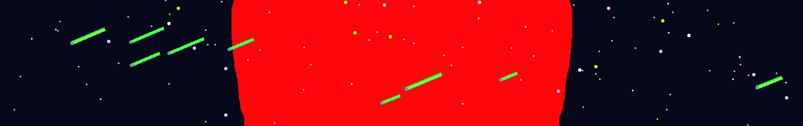

<!-- STAR RAIN ANIMATION -->

  

<!-- HERO SECTION -->

<h1 align="center">
  David Nieto Heras
</h1>

<h3 align="center">
  Software Developer
</h3>

<!-- TYPING EFFECT -->

  

 

<!-- CONTACT BUTTONS -->

  
  
  

 

## Sobre mí

¡Hola! Soy David, tengo 19 años y actualmente estoy cursando 2.º de Desarrollo de Aplicaciones Multiplataforma (DAM).

Me apasiona el mundo de la programación y el desarrollo de software. Disfruto aprendiendo, afrontando nuevos retos y buscando soluciones a diferentes problemas mediante la tecnología.

🎓 Actualmente cursando 2.º de DAM.

💡 Apasionado por la programación y la innovación tecnológica.

🧠 Me gusta aprender cosas nuevas y mejorar continuamente.

🔍 Disfruto resolviendo problemas y buscando soluciones eficientes.

🤝 Me considero una persona responsable, trabajadora y con capacidad de adaptación.

🚀 Busco oportunidades para participar en proyectos reales, poner en práctica mis conocimientos y seguir creciendo como desarrollador.

🎯 Mi objetivo es mejorar mis habilidades profesionales y aportar valor a los equipos y proyectos en los que participe.

## Tecnologías

<h2 align="center">TECNOLOGÍAS Y HERRAMIENTAS</h2>

  <strong>Backend & Frameworks</strong>
    
  

  <strong>Frontend & Web</strong>
    
  

  <strong>Bases de datos</strong>
    
  

  <strong>Móviles & Herramientas de desarrollo</strong>
    
  

## Proyectos Destacados

<table width="100%">
<tr>
<td width="50%" valign="top">

<h3>🍽️ Restaurante - El Mesón</h3>

2025

Diseño y desarrollo de un sitio web corporativo interactivo para un restaurante de mi pueblo. Implementación de una interfaz moderna, limpia y optimizada para la navegación móvil.

<a href="https://davidn1210.github.io/UT4_Practica1_ElMeson/">
Ver Proyecto →
</a>

 

</td>
<td width="50%" valign="top">

<h3>🏗️ Arquidata - DAW Projecto Final</h3>

2026

Se trata de una aplicación web que sirve para hacerle la vida más fácil a los arquitectos, facilitándoles la convesación con el cliente, la gestión de su trabajo y la transferencia de planos.

<a href="https://github.com/DavidN1210/Arquidata_ProyectoFinal">
Ver Repositorio →
</a>

 

</td>
</tr>
</table>

